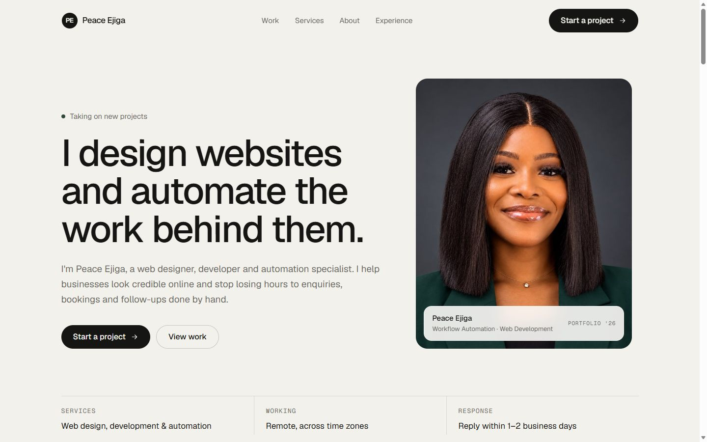

# Peace Ejiga · Portfolio

**Live site: [peace-ejiga.vercel.app](https://peace-ejiga.vercel.app)**

My portfolio website. I design websites and build workflow automations that take repetitive work off small teams: enquiries, bookings, reminders and follow-ups.



## What's inside

**Selected work**

| Project | What it is | Built with |
| --- | --- | --- |
| Telegram Booking Assistant | AI assistant that answers questions, saves customers and books appointments in one chat | n8n, OpenAI, Google Sheets, Google Calendar |
| Telegram Meal Tracker | Log meals by text, voice or photo, get progress reports with charts | n8n, Google Gemini, Google Sheets |
| Order Reminder Automation | Finds orders that need a follow-up, emails the customer and marks the row | n8n, Google Sheets, Gmail |
| Haven Stays | Vacation-rental website template: search, filters, nightly prices, price estimate pop-up, FAQ | HTML, CSS, JavaScript |

The Haven Stays template lives in [`public/sites/rental`](public/sites/rental) and runs as a standalone page.

**Site features**

- Floating header that follows you as you scroll, with section highlighting
- Project case studies (problem, process, solution, result)
- Working contact form (Formspree) with validation and spam protection
- Responsive from phone to desktop, keyboard accessible, respects reduced motion

## Tech

React, Vite, Tailwind CSS, React Router. Hosted on Vercel.

## Run it locally

```bash
npm install
npm run dev      # local development
npm run build    # production build in dist/
```

## Editing content

All text lives in data files, not in the components:

- `src/data/site.js`: profile, services, process, experience, education
- `src/data/projects.js`: portfolio projects and case studies
- `src/data/contact.js`: email, LinkedIn, WhatsApp, GitHub, form endpoint

## Contact

- Email: [peaceomachunyiejiga@gmail.com](mailto:peaceomachunyiejiga@gmail.com)
- LinkedIn: [Peace Ejiga](https://www.linkedin.com/in/peace-ejiga-2055aa290/)

© Peace Ejiga. Photos in the rental template are from Unsplash (see `public/sites/rental/img/CREDITS.txt`).
